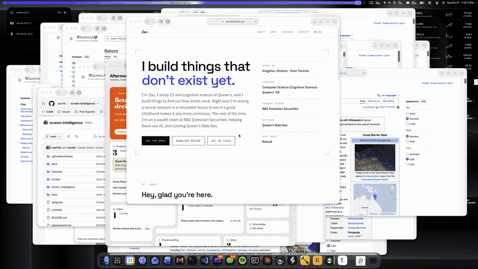
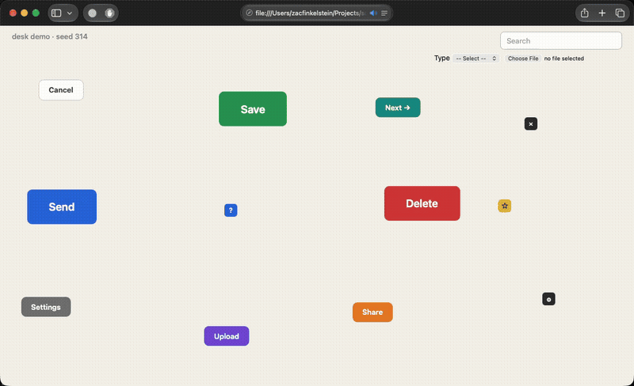

# Screen Intelligence

[](https://github.com/zacfink/screen-intelligence/actions/workflows/tests.yml)

Lets an AI agent use a Mac: see the screen, click, type, fill in forms. The main tool is `desk`, a command-line
"hands and eyes" for [Claude Code](https://claude.com/claude-code). Claude plans the work, and a small, fast
decision model, [Jev](https://typesafe.ai) by TypeSafe, does the looking and clicking. So Claude only decides
"now what?" between batches instead of reading a screenshot before every click.

In use, it filled in a real internship application (posting search, three file uploads, document package) and
stopped before Submit, which it leaves to a person.



*20 messy Safari windows tidied into a grid with `desk drag`, the real mouse doing every move (20x speed). A short
script works out each window's cell; desk does the dragging.*



*`desk do` running a 9-step plan in real time: type a search, pick "Resume" from a dropdown, then click Save, the
star icon, Share and the tiny ? button. Every step landed.*

## How fast and how accurate

Measured with `desk demo` and `desk train` (a test page of 12 buttons, big to tiny icons, in random places):

| | |
|---|---|
| Find a button from pixels (`desk find`) | 47 of 48 hit, ~0.6 s each |
| Click a button chosen from the accessibility tree | 39 of 39 right |
| One step of an agent run (`desk do`) | ~1.2 s per click, typing ~100 wpm |
| Yes/no question about the screen (`desk see`) | ~1 s, ~10 tokens instead of a ~1,200-token screenshot |

Misses come with low confidence (~0.1 vs ~0.8 for hits), so `find` refuses to click under 0.6.

## How it works

```
Claude Code ── writes a plan ──▶ desk do "Click Upload, then choose "Resume", then attach "/path/cv.pdf""
                                    │
          for each step:            ▼
          plain step? (type, press, choose, attach, open) ──▶ just do it, no model call
          otherwise: screenshot + accessibility tree ──▶ Jev ──▶ which move, which element / where
                                    │
                                    ▼
          click / key / type ──▶ did the screen change? done? risky? ──▶ next step
                                    │
                                    ▼
          ~20-line text report of the page ──▶ back to Claude for "now what"
```

- **Accessibility first.** `desk ui` reads an app's buttons, fields and labels as text (exact and free). Pixels
  (`desk find`, Jev's Box question) are the fallback for apps that draw their own UI, and when a label points
  somewhere other than where Jev sees the target, the pixels win.
- **Two-pass find.** Jev boxes the target on the whole screen, then again on a close-up crop around that box,
  which is about twice as exact.
- **Safety.** Every step checks for risky moves (send, submit, delete, pay) and stops before them. It stops if you
  move the mouse or switch apps, refuses unsure clicks, and can be pinned to one page (`--only-url`) so practice
  runs can't touch a real tab. Slam the mouse into a screen corner to abort anything (pyautogui's fail-safe).

## Commands

```bash
desk ui [--find TEXT] [App]          # the window's buttons, fields and labels as numbered lines
desk see "Did the form submit?"      # Jev: yes/no about the screen, as a probability
desk find "the blue Submit button"   # Jev: where it is; then `desk click @`
desk highlight "the Wi-Fi icon"      # screenshot with a red box around it, opened in Preview
desk shot                            # 1280-wide screenshot with a grid, for when text isn't enough
desk click #N | @ | X Y              # click an element, the last find, or a point
desk type [--natural] "text"         # paste, or type key by key like a person
desk run "click #4; type hi; key return"   # several steps, stops on the first that doesn't take
desk do "Click X, then type "hi", then press return"   # Jev drives a written plan, step by step
desk recipe NAME key=value...        # a saved plan with blanks, e.g. recipes/quip-apply.txt
desk demo [jev|ui]                   # scored test page of random buttons
desk train [N]                       # N random practice tasks on the demo page, every move scored
```

`docs/desk.md` explains the batching and change-checking in more detail.

## Setup

macOS only. It's set up for my machine, so expect to adjust paths:

- Python 3.10 with `requirements.txt`.
- Jev runs in its own Python 3.12 venv at `~/.venvs/typesafe` with `typesafe-sdk` 0.7.5+, and needs
  `TYPESAFE_API_KEY`. Images and Box are TypeSafe beta features, so desk asks for `jev-1.14.0` by name.
- The `desk` launcher (in `~/.local/bin`) shows a notification and waits 3 seconds before taking the mouse after
  5 idle minutes.
- Grant Screen Recording and Accessibility to whatever runs it (for Claude Code: `ClaudeCode.app`).

Tests (nothing touches the real mouse or the network; CI runs them on macOS):

```bash
python -m unittest
```

## Also in here: the 2025 prototype

`python -m screen_intelligence "Open Safari and search for the weather in Kingston"` runs the original
experiment: GPT-4o describes a screenshot, plans steps from a fixed action vocabulary
(`screen_intelligence/action_list.json`), acts, compares before/after screenshots and replans on failure. It
needs an OpenAI key and Tesseract (OCR fallback). It's a prototype: coordinates come from a text description of
the screen, so they're guesses, and which steps ask for confirmation is up to the model. Its pieces are `agent.py`,
`llm.py`, `models.py`, `actions.py`, `ocr.py` and `screenshots.py`; desk's are `desk.py`, `desk_do.py`,
`jev_look.py`, `desk_demo.py`, `desk_train.py` and `jev_type.py`.

## Rough edges

- `desk do` is for routine clicking through known screens. Jev judges one step well but loses track of order, so
  the plan has to come from the caller.
- Safari only opens a file picker after one real click on the page in some cases; `attach` says so when it happens.
- `desk jevtype` (Jev writing text one word at a time) works, but the grammar is rough. It's an experiment.

MIT licensed.
